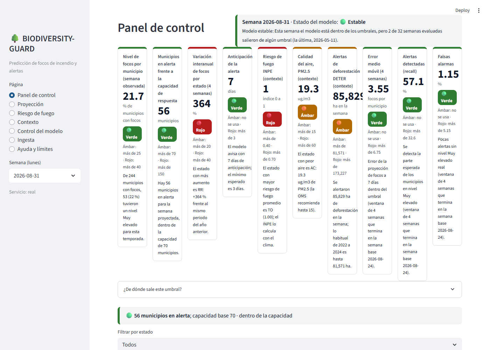
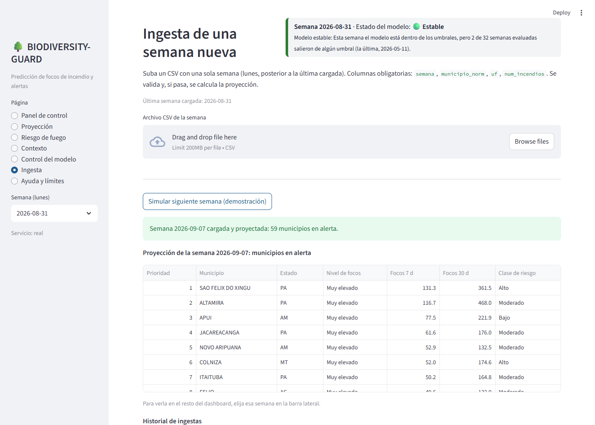
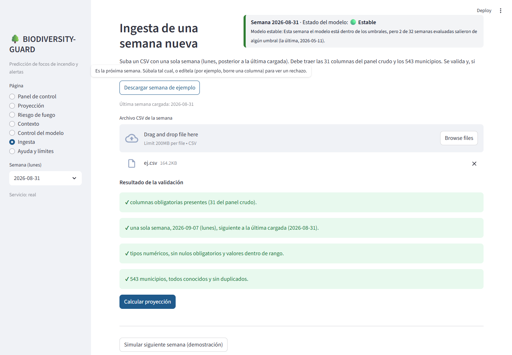

# Manual del usuario: dashboard BIODIVERSITY-GUARD

Guía corta para quien usa el dashboard cada semana. Predice focos de calor por municipio a 7 y 30 días, marca municipios en alerta y avisa si el modelo se está degradando. Los umbrales citados salen de `docs/fichas_kpi.json`.

## 1. Qué hay en cada página

Se elige en la barra lateral. Debajo está el selector **Semana (lunes)**; todas las páginas muestran la semana elegida.

| Página | Qué ve | Para qué sirve |
|---|---|---|
| **Panel de control** | Tarjetas de KPI con semáforo, aviso de capacidad y la tabla de municipios en alerta por prioridad. | Ver el resumen de la semana y decidir a qué municipios atender primero. |
| **Proyección** | Focos proyectados a 7 y 30 días por estado y por municipio, real contra predicho y mapa por nivel de focos. | Ver dónde se espera más fuego. |
| **Riesgo de fuego** | Clase de riesgo (Bajo, Moderado, Alto, Crítico) por municipio y probabilidad de Crítico. | Priorizar según la gravedad esperada. |
| **Contexto** | Riesgo de fuego INPE, PM2.5 y deforestación DETER por estado. | Dar contexto; no entra al cálculo de las alertas. |
| **Control del modelo** | Series de error móvil, recall de alerta y falsas alarmas con su umbral. | Saber si el modelo sigue siendo confiable. |
| **Ingesta** | Carga de una semana nueva y su proyección. | Actualizar el dashboard cada semana. |
| **Ayuda y límites** | Colores, estado del modelo y límites declarados. | Consulta rápida. |

En la parte superior de todas las páginas hay una franja con el **estado del modelo** (Estable, Vigilancia o Reentrenar recomendado).

## 2. Cómo leer los semáforos

Cada tarjeta del panel muestra el valor, un color con su texto y debajo los umbrales de su ficha. El color nunca va solo: siempre tiene la palabra Verde, Ámbar o Rojo.

| Color | Significa |
|---|---|
| **Verde** | Dentro de lo esperado. |
| **Ámbar** | Cerca del límite. Solo existe en algunos KPI. |
| **Rojo** | Fuera del umbral. |
| **Sin dato** | Aún no hay dato real para calcularlo. |

**Ojo con el ámbar:** los tres KPI de control del modelo (error medio móvil, recall de alerta y falsas alarmas) y la anticipación de la alerta **no tienen tramo ámbar**; solo verde o rojo. La tarjeta lo indica con «Ámbar: no se usa».

Umbrales de los KPI de control (sacados de las fichas):

| KPI | Verde | Rojo |
|---|---|---|
| Error medio móvil de 4 semanas (focos por municipio) | Hasta 6.752 | Más de 6.752 |
| Recall de alerta (ventana de 8 semanas) | 0.326 o más | Menos de 0.326 |
| Tasa de falsas alarmas (ventana de 8 semanas) | Hasta 0.0515 | Más de 0.0515 |

KPI con tramo ámbar:

| KPI | Verde | Ámbar | Rojo |
|---|---|---|---|
| Nivel de focos (% de municipios con focos en Muy elevado) | Hasta 25 % | 25 % a 40 % | Más de 40 % |
| Municipios en alerta frente a la capacidad | Hasta 70 | 71 a 150 | Más de 150 |
| Variación interanual de focos por estado | Hasta 20 % | 20 % a 40 % | Más de 40 % |
| Riesgo de fuego INPE (contexto) | Menor a 0.4 | 0.4 a 0.7 | Mayor a 0.7 |
| PM2.5 (contexto) | Hasta 15 ug/m3 | 15 a 60 ug/m3 | Más de 60 ug/m3 |
| Deforestación DETER (contexto) | Hasta 81,571 ha | 81,571 a 173,227 ha | Más de 173,227 ha |

Cada tarjeta tiene un desplegable **«¿De dónde sale este umbral?»** con la base de cada límite (dato pasado o supuesto del negocio).

**Estado del modelo** (franja superior):
- **Estable:** las últimas 4 semanas dentro de umbral.
- **Vigilancia:** una semana fuera de umbral.
- **Reentrenar recomendado:** dos o más semanas fuera de umbral.

## 3. Cómo subir una semana

1. Entre a **Ingesta**. Arriba se indica la última semana cargada.
2. Prepare un CSV con **una sola semana**. La fecha debe ser un **lunes** y posterior a la última cargada. Columnas obligatorias: `semana`, `municipio_norm`, `uf` y `num_incendios` (numérico y no negativo).
3. Arrastre el archivo o use **Browse files**. El dashboard valida el archivo y muestra cada comprobación.
4. Si todo sale en verde, pulse **Calcular proyección**. Si hay un error rojo, corrija el archivo y vuelva a subirlo.
5. Aparece la tabla de municipios en alerta de la semana proyectada. Para verla en el resto de las páginas, elija esa semana en la barra lateral.

*Captura con el servicio de ejemplo: muestra la lista de comprobaciones antes de calcular.*

El botón **Simular siguiente semana (demostración)** carga la semana siguiente de la simulación 2026 sin subir un archivo; sirve para ensayar. Al subir la semana siguiente, el dashboard compara la proyección anterior con lo observado y actualiza los KPI de control y el estado del modelo.

## 4. Qué hacer en ámbar o rojo

| Situación | Acción sugerida |
|---|---|
| **Nivel de focos** en ámbar o rojo | Revisar la lista de municipios en Muy elevado y confirmar con la brigada local si hay incendios activos. |
| **Municipios en alerta** en ámbar o rojo | Atender por orden de prioridad, pedir apoyo de brigadas de otros estados y confirmar la capacidad real con la autoridad. |
| **Variación interanual** en ámbar o rojo | Mirar el estado y el mes, comparar con las lluvias y reforzar la prevención en ese estado. |
| **Riesgo de fuego INPE** en ámbar o rojo | Tomarlo como aviso de condiciones secas y combinarlo con las alertas del modelo. |
| **PM2.5** en ámbar o rojo | Avisar a salud pública y recomendar evitar esfuerzo físico al aire libre. |
| **Deforestación DETER** en ámbar o rojo | Cruzar con focos en el mismo municipio, porque la deforestación suele anteceder al fuego. |
| **Error móvil** en rojo | Revisar los datos de entrada; si se repite dos semanas seguidas, pedir el reentrenamiento. |
| **Recall de alerta** en rojo | No confiar solo en el modelo y apoyarse en el nivel de focos observado; dos semanas seguidas, reentrenar. |
| **Falsas alarmas** en rojo | Revisar si la lista de alertas supera la capacidad y confirmar en terreno antes de movilizar equipos. |
| **Anticipación** en rojo | El aviso llega tarde; revisar si el modelo cambió de horizonte antes de usar las alertas. |

## 5. Límites conocidos

- Los datos de 2026 son **simulados** con fuentes públicas (INPE, NASA POWER y SISAM). El dashboard demuestra el flujo, no vigila incendios reales.
- El SISAM de 2026 es un **pronóstico sin calibrar**.
- La **capacidad de respuesta (70 municipios)** es un supuesto derivado de 1,489 brigadistas; no existe dato oficial.
- El modelo **subestima los picos**: los errores se concentran en la temporada seca y en los municipios con más de 20 focos.
- Con datos semanales **no se conoce el día exacto** del incendio ni se mide la anticipación real de la alerta.
- La detección es parcial: en 2025 el recall de alerta fue 0.494. Un municipio sin alerta no garantiza que no habrá fuego.
- Los focos dependen del paso del satélite y de las nubes; un municipio grande acumula más focos que uno pequeño.
- El riesgo de fuego INPE se deriva del clima y puede ser alto sin focos reales; PM2.5 viene de un reanálisis, no de una estación de medición.
- Los modelos de focos y de clase de riesgo no cumplen todos los criterios de éxito fijados (a 7 días y en la clase de riesgo quedan por debajo; a 30 días se cumple solo en validación). Úselos como apoyo a la decisión, no como única fuente.
